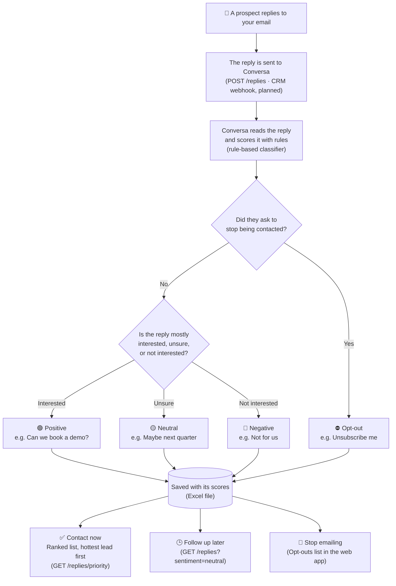
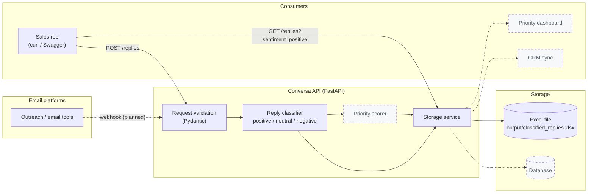
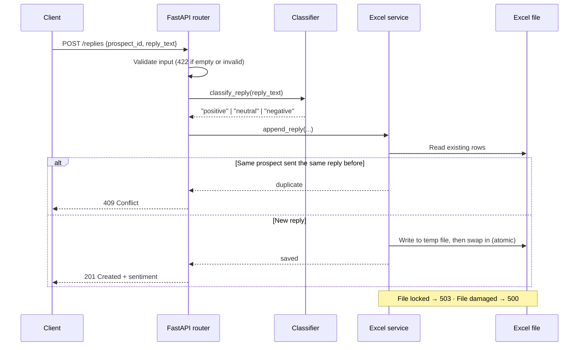

# Conversa

**Conversa tells sales teams which email replies to act on first.**

**Live app:** [conversa.fastapicloud.dev](https://conversa.fastapicloud.dev/)

## Problem

- 10,000 outreach emails sent
- 2,000 replies received
- The replies are mixed: interested, undecided, not interested, opt-outs and auto-replies
- Sorting them by hand is slow, and hot leads go cold while they wait

## Solution

Conversa classifies every reply by sentiment, so the team knows who to contact now, who to follow up with later, and who to stop emailing.

## At a glance



**In plain words:** a prospect replies → Conversa reads the reply → it decides whether they're interested, unsure, not interested, or asking to unsubscribe → the sales team gets a ranked lis[...]

**For engineers:** replies come in through `POST /replies` (a CRM webhook is on the [roadmap](#roadmap)). The rule-based classifier in [`app/services/classifier.py`](app/services/classifier.py) scores[...]

---

## Contents

- [How it works](#how-it-works)
- [High-level design](#high-level-design)
- [Project status](#project-status)
- [Local setup](#local-setup)
- [API reference](#api-reference)
- [Running tests](#running-tests)
- [Project structure](#project-structure)
- [Roadmap](#roadmap)

---

## How it works

Every reply is classified into one of three groups, each with a clear next step:

| Sentiment | What it means | Example | Next step |
|---|---|---|---|
| **Positive** | Interested, wants to talk | "Tell me more, can we schedule a demo?" | **Act now.** Book the call. |
| **Neutral** | Undecided, deferred, or auto-reply | "Maybe next quarter", "Out of office" | **Nurture.** Follow up later. |
| **Negative** | Not interested or opt-out | "Not for us", "Unsubscribe me" | **Stop.** Remove from the sequence. |

The classifier is rule-based, so it's fast, free to run and easy to explain. It handles:

- **Negation:** "I'm *not really* interested" → negative
- **Contrast:** "Not right now, *but* tell me more" → positive (what comes after "but" counts more)
- **Conflicting signals:** "Interested, but not sure" → neutral
- **Deferrals:** "Not interested right now, maybe next quarter" → neutral, not a lost lead
- **Opt-outs:** "unsubscribe", "do not contact" → always negative, so they're always honoured

Each phrase in the classifier has a weight (1 = weak hint, 2 = clear, 3 = strong). The label with the highest total wins, and a near-tie becomes neutral. The phrase lists and weights are at the to[...]

---

## High-level design

Solid boxes are built. Dashed boxes are planned .



### Request flow: `POST /replies`



### Components

| Component | File | Responsibility |
|---|---|---|
| API app | [`app/main.py`](app/main.py) | FastAPI app, health check, router registration, serves the web page |
| Web app | [`app/static/index.html`](app/static/index.html) | Classify form, priority queue and replies table |
| Replies router | [`app/routers/replies.py`](app/routers/replies.py) | `POST` and `GET /replies`; maps storage failures to clear HTTP errors |
| Schemas | [`app/schemas/reply.py`](app/schemas/reply.py) | Request and response models, input validation |
| Classifier | [`app/services/classifier.py`](app/services/classifier.py) | Rule-based intent classification |
| Excel service | [`app/services/excel_service.py`](app/services/excel_service.py) | Read and append replies, de-duplicate, atomic writes |

---

## Project status

Conversa is an early MVP.

**Working today**
- Classify a reply as positive, neutral or negative, with the scores behind the label
- Save classified replies and their scores to an Excel file
- Get saved replies, filtered by sentiment or prospect, and sorted by score
- A ranked priority queue for sales reps (`GET /replies/priority`)
- Skip duplicate replies
- Clear error responses for bad input and for Excel file problems

**Not built yet:** integrations with email platforms, a database, and a dashboard. See [Roadmap](#roadmap).

---

## Local setup

### Prerequisites

- **Python 3.12+**
- **[uv](https://docs.astral.sh/uv/)** for dependencies and the virtual environment

Install uv if you don't have it:

```bash
# macOS / Linux
curl -LsSf https://astral.sh/uv/install.sh | sh

# or with Homebrew
brew install uv
```

### 1. Clone the repository

```bash
git clone <repository-url>
cd Conversa
```

### 2. Install dependencies

```bash
uv sync
```

This creates a `.venv/` folder and installs the exact versions pinned in `uv.lock`, including the dev tools (pytest).

### 3. Start the server

```bash
uv run uvicorn app.main:app --reload
```

The API runs at **http://127.0.0.1:8000**. `--reload` restarts the server when you change the code.

### 4. Check that it works

```bash
curl http://127.0.0.1:8000/health
# {"message":"Conversa is healthy!"}
```

Open **http://127.0.0.1:8000/** for the web app: classify replies, see the priority queue, and browse all replies.

Open **http://127.0.0.1:8000/docs** for interactive API docs where you can send requests from the browser.

### 5. Classify your first reply

```bash
curl -X POST http://127.0.0.1:8000/replies \\
  -H 'Content-Type: application/json' \\
  -d '{"prospect_id": "P001", "reply_text": "I am interested, can we schedule a demo?"}'
```

The reply is saved to `output/classified_replies.xlsx`, which is created automatically. The `output/` folder is git-ignored because it holds prospect data.

---

## API reference

### `GET /health`

Returns `200` if the service is running.

### `POST /replies`

Classify a reply and save it.

**Request**

```json
{
  "prospect_id": "P001",
  "reply_text": "Not right now, but tell me more"
}
```

| Field | Rules |
|---|---|
| `prospect_id` | Required, 1–100 characters, surrounding spaces removed |
| `reply_text` | Required, 1–5000 characters, surrounding spaces removed |

**Response `201 Created`**

```json
{
  "prospect_id": "P001",
  "reply_text": "Not right now, but tell me more",
  "sentiment": "positive",
  "positive_score": 3.0,
  "negative_score": 0.0,
  "neutral_score": 2.0,
  "score_margin": 1.0,
  "opt_out": false,
  "message": "Reply classified and saved successfully"
}
```

| Field | Meaning |
|---|---|
| `positive_score`, `negative_score`, `neutral_score` | Total weight of the matching phrases for each label |
| `score_margin` | Winning score minus the runner-up. Higher means a clearer reply; use it to rank leads. |
| `opt_out` | `true` if the reply asked to unsubscribe or not be contacted. These are always `negative`. |

### `GET /replies`

Get saved replies. All parameters are optional and can be combined.

| Query parameter | Values |
|---|---|
| `sentiment` | `positive`, `neutral`, `negative` |
| `prospect_id` | Any prospect ID |
| `sort_by` | `score_margin`, `positive_score`, `negative_score`, `neutral_score` (highest first) |

Get the hottest leads first:

```bash
curl 'http://127.0.0.1:8000/replies?sentiment=positive&sort_by=score_margin'
```

**Response `200 OK`**

```json
{
  "count": 1,
  "replies": [
    {
      "prospect_id": "P001",
      "reply_text": "Not right now, but tell me more",
      "sentiment": "positive",
      "positive_score": 3.0,
      "negative_score": 0.0,
      "neutral_score": 2.0,
      "score_margin": 1.0,
      "opt_out": false
    }
  ]
}
```

If no replies have been saved yet, it returns `{"count": 0, "replies": []}`. Replies saved before scores were added have `null` scores and are listed last when sorting.

### `GET /replies/priority`

The sales rep's work queue: positive replies ranked by `score_margin`, highest first. Negative and neutral replies are not included.

| Query parameter | Default | Values |
|---|---|---|
| `limit` | `50` | 1–500 |

```bash
curl 'http://127.0.0.1:8000/replies/priority?limit=20'
```

**Response `200 OK`**

```json
{
  "count": 2,
  "replies": [
    {
      "prospect_id": "P002",
      "reply_text": "Book a call and sign me up",
      "sentiment": "positive",
      "positive_score": 6.0,
      "negative_score": 0.0,
      "neutral_score": 0.0,
      "score_margin": 6.0,
      "opt_out": false,
      "rank": 1
    },
    {
      "prospect_id": "P003",
      "reply_text": "Tell me more",
      "sentiment": "positive",
      "positive_score": 2.0,
      "negative_score": 0.0,
      "neutral_score": 0.0,
      "score_margin": 2.0,
      "opt_out": false,
      "rank": 2
    }
  ]
}
```

### Error responses

| Status | When |
|---|---|
| `409 Conflict` | The same prospect already sent this exact reply |
| `422 Unprocessable Entity` | Missing, empty or invalid fields, or an unknown `sentiment` filter |
| `500 Internal Server Error` | The Excel file is damaged, has the wrong columns, or can't be read or written |
| `503 Service Unavailable` | The Excel file is locked by another program (e.g. open in Excel on Windows); includes `Retry-After: 10` |

Error responses never include file paths or other internal details. Those are written to the server log.

---

## Running tests

```bash
uv run pytest
```

Tests use a temporary Excel file, so they never touch your real `output/` data.

| Test file | Covers |
|---|---|
| [`tests/test_classifier.py`](tests/test_classifier.py) | Negation, contrast, deferrals, opt-outs, ambiguous replies |
| [`tests/test_excel_service.py`](tests/test_excel_service.py) | Saving, de-duplication, filtering, damaged and locked files |
| [`tests/test_replies_router.py`](tests/test_replies_router.py) | HTTP status codes for each error case |

When you add a phrase to the classifier, add a test case for it too.

---

## Project structure

```
Conversa/
├── app/
│   ├── main.py                 # FastAPI app, web page and health check
│   ├── routers/
│   │   └── replies.py          # /replies endpoints
│   ├── schemas/
│   │   └── reply.py            # Request/response models
│   ├── services/
│   │   ├── classifier.py       # Reply classification rules
│   │   ├── excel_service.py    # Excel storage
│   │   └── priority.py         # Priority queue ranking
│   └── static/
│       └── index.html          # Web app (plain HTML/JS, no build step)
├── tests/                      # pytest suite
├── output/                     # Generated Excel file (git-ignored)
├── pyproject.toml              # Dependencies and pytest config
└── uv.lock                     # Pinned dependency versions
```


